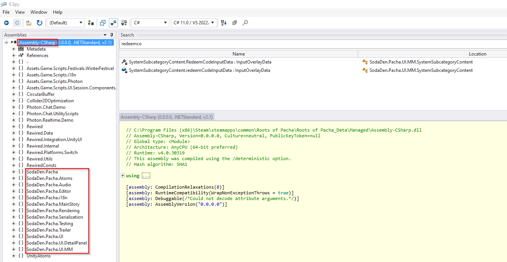
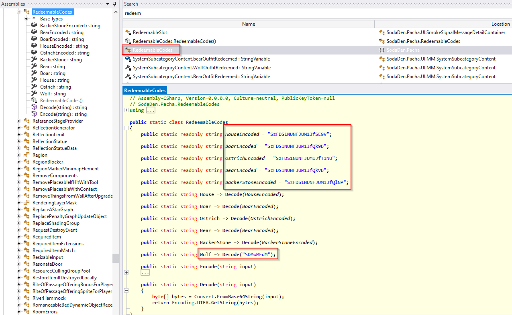
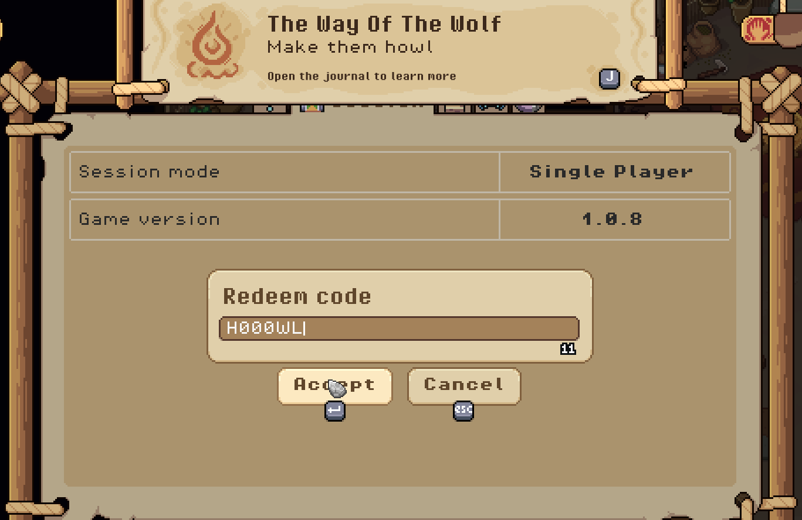
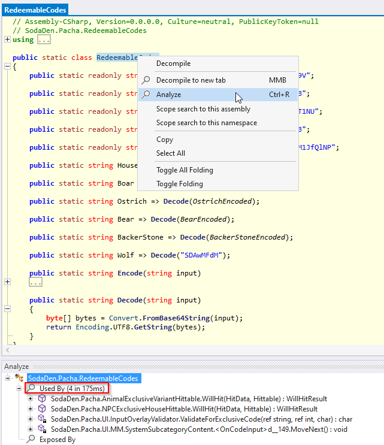

## Motivation

A while back I backed [Roots of Pacha](https://rootsofpacha.com) on Kickstarter, a prehistoric farming sim made by the indie studio [SodaGen](https://sodaden.com). I ended up with two copies of the game.

As a backer I was supposed to get a set of exclusive unlock codes, but I only received the most basic one, the one matching the tier I pledged for. What caught my eye was that both copies gave me the exact same code, which meant one thing:

> **the codes are static per reward tier**, not per player or per copy.

That single detail was enough to get my *gamer greed* going. If the codes don't depend on who you are, maybe there's a way to see what the higher tiers look like without paying for them. So I opened the game up to find out, and this post walks through what I found.

## Tools

First step: grab [ILSpy](https://github.com/icsharpcode/ILSpy), a cross-platform .NET decompiler. It needs the [.NET Desktop Runtime 6.0.16](https://dotnet.microsoft.com/en-us/download/dotnet/6.0) installed alongside it, so get that too.

Once both are in place, load `Assembly-CSharp.dll` into ILSpy. On a Steam install you'll find it under `%ProgramFiles(x86)%\Steam\steamapps\Roots of Pacha\Roots of Pacha_Data`.



## Studying the code

### Looking for gold

With the assembly loaded, I started searching for the obvious keywords: **key**, **code**, **redeem**. That turned up a static class named `RedeemableCodes`, holding what looked like base64-encoded strings.



Decoding them gave this:

```cs
public static readonly string HouseEncoded = "SzFDS1NUNFJUM1JfSE9V"; // K1CKST4RT3R_HOU
public static readonly string BoarEncoded = "SzFDS1NUNFJUM1JfQk9B"; // K1CKST4RT3R_BOA
public static readonly string OstrichEncoded = "SzFDS1NUNFJUM1JfT1NU"; // K1CKST4RT3R_OST
public static readonly string BearEncoded = "SzFDS1NUNFJUM1JfQkVB"; // K1CKST4RT3R_BEA
public static readonly string BackerStoneEncoded = "SzFDS1NUNFJUM1JfQlNP"; // K1CKST4RT3R_BSO
```

Promising, except none of these match the `XXXX-XXXX-XXXX-XXXX` format the real Kickstarter codes use, and none of them work in-game either. Dead end, or so it seemed.

### Hardcoding is my life

While going through the rest of `RedeemableCodes`, one entry stood out because it was declared differently from the others, and its decoded value didn't follow the `K1CKST4RT3R_` naming pattern at all.

```cs
public static string Wolf => Decode("SDAwMFdM"); // H000WL
```

Out of curiosity more than expectation, I typed `H000WL` into the game's code redemption screen. And it worked.



That code unlocks a wolf skin, similar to *[Okka](https://rootsofpacha.fandom.com/wiki/Okka)*. Small win, but a real one.

### A bitter end

Curious why this one code behaved differently, I used ILSpy's **Analyze** feature (`Ctrl+R`) to trace every place `RedeemableCodes` gets referenced.



That led to `MoveNext`, inside `SodaDen.Pacha.UI.MM.SystemSubcategoryContent.<OnCodeInput>d__149`. The relevant check looks like this:

```cs
<error>5__5 = false;
<invalidCode>5__6 = false;
<codeResult>5__7 = null;
if (result == RedeemableCodes.Wolf)
{
	<codeResult>5__7 = "Wolf";
	goto IL_0400;
}
<webRequest>5__8 = UnityWebRequest.Get("https://us-central1-roots-of-pacha-pledgebox.cloudfunctions.net/orders/validate-code?code=" + result.Replace("-", ""));
goto IL_02b0;
```

And there's the answer: `Wolf` is the only code checked locally, with a plain string comparison. Every other code gets sent off to an API for validation. I poked at that endpoint a bit, and a bogus code returns a `400 Bad Request`:

```http
GET /orders/orders/validate-code?code=11111111111111111111 HTTP/2
Host: us-central1-roots-of-pacha-pledgebox.cloudfunctions.net
User-Agent: Roots of Pacha/RE
Accept: */*
```

```http
HTTP/2 400 
x-powered-by: Express
vary: Origin
content-type: text/plain; charset=utf-8
etag: W/"b-EFiDB1U+dmqzx9Mo2UjcZ1SJPO8"
function-execution-id: dzp46qom6e3i
x-cloud-trace-context: 00dcb74056fb9e32b8b25a6811903c73;o=1
date: Thu, 04 May 2023 14:33:31 GMT
server: Google Frontend
content-length: 11
alt-svc: h3=":443"; ma=2592000,h3-29=":443"; ma=2592000

Bad Request
```

A valid code, on the other hand, comes back with an identifier that gets picked up by the same `MoveNext` method:

```http
GET /orders/orders/validate-code?code=<REDACTED> HTTP/2
Host: us-central1-roots-of-pacha-pledgebox.cloudfunctions.net
User-Agent: Roots of Pacha/RE
Accept: */*
```

```http
HTTP/2 200 
x-powered-by: Express
vary: Origin
content-type: text/html; charset=utf-8
etag: W/"c-axJCePMEBUBMGYDipb7BeNjTSIg"
function-execution-id: xjaf1wrdjzs0
x-cloud-trace-context: 3a0ad57b00afc686ac7535a264c7cc4b;o=1
date: Thu, 04 May 2023 14:38:46 GMT
server: Google Frontend
content-length: 12
alt-svc: h3=":443"; ma=2592000,h3-29=":443"; ma=2592000

Backer_Stone
```

And that's where the trail runs cold. Each code is 12 alphanumeric characters, which is roughly 4.7 quintillion combinations, and only a handful of those are actually valid.

> Brute-forcing that endpoint isn't just impractical, it would also mean attacking a server I have no authorization to touch. Not something I'm willing to do, and not something I'd suggest either.

## Conclusion

Walking away with one extra code wasn't the jackpot I was hoping for, but it wasn't nothing either. `RedeemableCodes.Wolf` clearly got wired up differently from the rest, most likely something thrown in last-minute without going through the same validation path. Lucky for me it happened to be checkable client-side.

I might come back to this at some point. Getting every reward is still tempting, and I've since noticed [other promotions](https://rootsofpacha.com/festival/) tied to the game's demo build that don't seem to work on the current version. That's a rabbit hole for another day.
